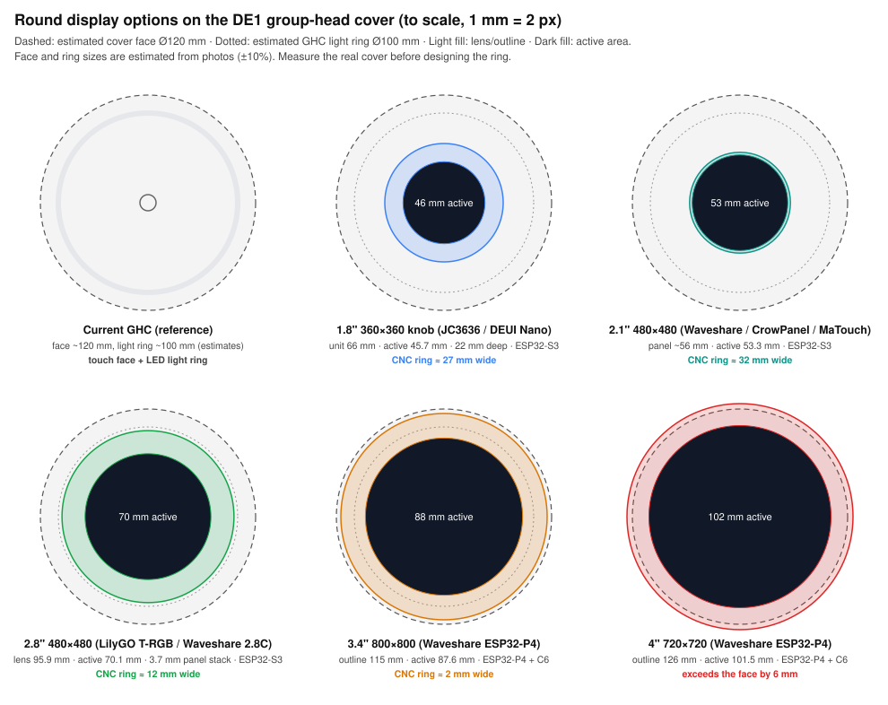

# GHC display replacement: size, displays and power

October 2026. This builds on `ghc-replacement-feasibility.md`. The direction here: remove the GHC so the DE1 accepts Bluetooth starts, and put a round ESP32 display in its place. The display connects over BLE (DEUI's existing stack), draws power from the GHC wiring, and sits in a CNC-machined ring so it looks first-party.

## Recommendation

Go with a **2.8" round 480×480 IPS on an ESP32-S3**.

- Its cover lens is 95.9 mm across, roughly the size of the current GHC light ring.
- That leaves about a 12 mm CNC ring on a ~120 mm cover face.
- The panel and lens together are only 3.7 mm thick.
- It's the same MCU family as DEUI Nano, so most of the firmware carries over.

For the build:

1. **Prototype on the LilyGO T-RGB 2.8".** LilyGO publish a full 3D STEP model and dimensioned drawings, so you can CAD the ring around a real part. The Waveshare ESP32-S3-Touch-LCD-2.8C uses the same panel family as a fallback.
2. **For production,** move to a custom round PCB driving the bare 2.8" panel and lens.

Before any CAD, spend an evening with calipers, a multimeter and a thermocouple (checklist at the end). The cover size and the GHC port's power are both still estimates.

## What's physically there

From the de1app GHC render and the photos in the Brewing with Euan front-panel guide:

- **The GHC is the top face of the group-head cover.** The cover is a black plastic cylinder with a tail that runs back into the machine, held on by 5 T10 screws from underneath. The face has a touch surface, four function icons, a centre stop button, and an LED light ring near the edge.
- **Cover size is estimated, not measured.** Two independent photo scalings give similar answers:
  - The side view of the machine (DE1 depth 369 mm) gives about 105–120 mm diameter.
  - The underside view, scaled from the 58 mm group gasket and shower screen, gives about 120–130 mm.

  Working figure: **~120 mm face, ~100 mm light ring** (the ring is about 82% of the face in Decent's render). Treat both as ±10% until measured.
- **Inside the cover, from the bottom up:**
  - a layer of white insulation
  - a shaped aluminium heat-shield plate (3 Phillips screws)
  - two more insulation layers
  - the GHC PCB

  Decent clearly treats heat from the group as a design constraint. Keep the shield and insulation in any new design.
- **The GHC PCB is small.** It's about 34 mm round (Rev F), on four aluminium standoffs (about 12 mm diameter, small M2-size screws). It has a **6-pin connector (J13)** and a **separate yellow wire** screwed to one standoff. The yellow wire is most likely protective earth, so check continuity to the chassis. The connector looks like a 1.0 mm or 1.25 mm pitch JST-style part; confirm the pitch when you have it open.

## Display options

| Option | Active Ø | Outer Ø | Depth | Res (ppi) | MCU | Fit on ~120 mm face |
|---|---|---|---|---|---|---|
| 1.8" knob (JC3636 class, current DEUI Nano) | 45.7 mm | 66 mm unit | 22 mm | 360×360 (~200) | ESP32-S3 | Small. ~27 mm ring. Fastest proof of concept, since firmware is unchanged |
| 2.1" (Waveshare 2.1, CrowPanel 2.1 knob, MaTouch 2.1 rotary) | 53.3 mm | ~56 mm panel | n/a | 480×480 (~230) | ESP32-S3 | Fits, but needs a ~32 mm ring. That suits a rotating bezel |
| **2.8" (LilyGO T-RGB 2.8, Waveshare 2.8C)** | **70.1 mm** | **95.9 mm lens** | **3.66 mm panel + lens; T-RGB board ~18 mm** | **480×480 (~174)** | **ESP32-S3** | **Best balance. ~12 mm ring; lens ≈ GHC light ring** |
| 3.4" (Waveshare ESP32-P4-WIFI6-Touch-LCD-3.4C) | 87.6 mm | 115 mm outline | n/a | 800×800 (~232) | ESP32-P4 + C6 | Fills the face with a ~2 mm lip. Only if the face measures ≥ 120 mm |
| 4" (Waveshare ESP32-P4-WIFI6-Touch-LCD-4C) | 101.5 mm | 126 mm outline | n/a | 720×720 (~180) | ESP32-P4 + C6 | Too big. Overhangs the estimated face |

Notes:

- **2.8" panel detail** (LilyGO drawing, panel RY02-7038GA):
  - The bare LCD is 73.0 mm OD × 2.29 mm, with a 70.13 mm active area. Driver is ST7701S over 16/18-bit RGB with SPI init.
  - The touch lens is 95.86 ±0.1 mm OD, 0.7 mm glass, 1.125 mm touch stack, GT911 touch controller. It has a 12.6 mm black printed border, which gives a wide area to seat and gasket the lens without covering any pixels.
  - Operating range: -20 to +70 °C for the LCD, -20 to +85 °C for the touch panel.
- **The ESP32-P4 boards look premium but cost more work.** The P4 has no radio. BLE goes through an ESP32-C6 co-processor (esp_hosted), which means porting DEUI's NimBLE client across. They also draw more power and run hotter. Worth revisiting for a v2 if the face measures large.
- **Round AMOLED tops out at 1.75" in this market** (466×466). That's too small for this face, despite the nicer blacks.
- **Pixel density is fine at 2.8".** 174 ppi viewed from 40–60 cm reads as sharp. The DEUI design language, with big numerals and arcs, scales up well.

## Thickness stack-up (2.8", custom PCB)

| Layer | Thickness |
|---|---|
| Cover glass + touch sensor + LCD (as supplied) | 3.66 mm |
| Gasket / adhesive under lens border | ~0.3–0.5 mm |
| Clearance to PCB | ~0.5 mm |
| PCB | 1.6 mm |
| Tallest parts (ESP32-S3-WROOM-1 module 3.1 mm, FPC connectors ~2 mm) | ~3.1 mm |
| **Total electronics depth below the top surface** | **~9–10 mm** |

The T-RGB dev board is about 18 mm deep, which is still likely to fit inside the cover above the heat shield. Measure the cavity depth to be sure.

**Antenna placement matters.** The module antenna must sit at the PCB edge, outside both the aluminium ring and the LCD's steel backplate, over the plastic part of the cover. Test BLE signal strength from the group head early. A quick check is to sit the current DEUI Nano on top of the group, since the DE1's BLE module is at the back of the chassis.

## Power

**What the device needs** (2.8" build; estimates from ESP32-S3 datasheet figures and typical round-panel backlights):

| State | Draw |
|---|---|
| Active: UI rendering + BLE connected + backlight ~70% | ~0.8–1.2 W (≈160–250 mA at 5 V) |
| Peak: Wi-Fi OTA transmit bursts | ~1.5–2 W (≈300–400 mA at 5 V) |
| Standby: backlight off, BLE kept alive with light sleep | target < 0.2 W |

**Sources, best first:**

1. **The GHC cable (preferred).**
   - It's already routed internally to exactly the right spot.
   - It's very likely always-on, because tapping the GHC wakes a sleeping DE1. The device needs that to wake the machine over BLE.
   - Use **only the power and ground pins**. Leave the data lines unconnected so the DE1 still reads "no GHC" (`0x80381C = 0`) and keeps allowing Bluetooth starts.
   - Unknowns: the voltage (3.3 V, 5 V or 12 V?) and how much current the DE1's rail can spare. The original GHC drives an RGB light ring, so a watt or so is plausible, but it needs measuring.
   - Design in an eFuse/current limiter set below the rail's capacity, soft-start to avoid inrush, and a buck converter to 3.3 V.
2. **The DE1's front USB port** (the tablet charging port).
   - It gives 5 V with plenty of current, sitting right beside the group head.
   - Its catch is that the DE1 firmware switches it. It's controlled by MMR `0x803854`, and the firmware turns it back on by itself about 10 minutes after it's switched off.
   - If DEUI is the only controller, it can simply keep the port on. Check it stays live while the machine sleeps.
   - It means an external cable run, so it's less integrated.
3. **A separate USB-C supply.** This is the simplest option for prototypes. Use it while the GHC rail is being characterised.

**Avoid two things:**

- A lithium battery at the group head (heat). The DEUI Nano battery path should be dropped for this variant.
- Tapping mains or internal DC-board rails.

**Earth bonding:** bond the CNC ring, and any exposed metal, to the existing yellow earth wire. The DE1 is an earthed appliance, and an unearthed metal ring on top of it isn't acceptable. It also helps with ESD on the touch panel.

## Heat and moisture

- **The ESP32-S3's PSRAM rating is the tightest limit.** Most round boards use octal PSRAM (S3R8 / N16R8), which Espressif rates to **65 °C ambient**. Enabling PSRAM ECC raises that to 85 °C, at the cost of 1/16 of the PSRAM. Turn ECC on. Quad-PSRAM parts are rated higher, but they're marginal for a 480×480 RGB framebuffer.
- **The LCD is rated to 70 °C.** Design for an internal temperature of 55–60 °C or less, and measure the real figure (checklist below).
- **Moisture caused ghost touches on Decent's own GHC.** They fixed it with a metal plate and gasket. For this device:
  - Gasket the lens to the ring.
  - Conformal-coat the PCB.
  - Require a deliberate gesture to start espresso, steam or water, such as press-and-hold or slide-to-start, never a single tap. That covers water droplets on the glass, and it's the right safety behaviour now that the GHC's UL interlock is gone.

## CNC ring

Your drip trays used CNC plus powder coat. For this part, **anodising is the better finish**. Powder coat adds roughly 60–100 µm and rounds edges, which would upset a 0.1 mm lens pocket.

- **Material:** 6061-T6 aluminium, bead-blasted and anodised (black or clear) to match DE1 finishes. 304 stainless is the premium alternative, but it's heavier and costs more to machine.
- **Geometry:**
  - Outer diameter matched to the measured cover face.
  - Stepped pocket at about 96.1 mm for the 95.86 ±0.1 mm lens, seated on a 1.5–2 mm ledge under the lens's black border.
  - The lens sits flush or 0.2 mm proud, with a small chamfer on the outer edge.
  - A gasket groove, or a thin VHB ring, under the lens.
- **Mounting:**
  - Locate the ring on the cover with a spigot.
  - Fasten it using the existing GHC standoff or screw positions (measure the bolt circle).
  - Add a tapped hole for the earth lug and a pass-through for the 6-pin cable.
- **Option: rotating bezel.** Make the ring rotate, with magnetic detents and a contactless magnetic angle sensor underneath. It stays sealed, matches DEUI Nano's rotary-ring interaction, and lets people adjust things without touching wet glass. It does add mechanical complexity, so treat it as a v2 idea unless the interaction is central.
- The T-RGB STEP model in the LilyGO repo is the reference body for CAD.

## Firmware impact (brief)

- **New board target in `firmware/esp32/main/board/`:**
  - ST7701S RGB panel with 3-wire SPI init
  - GT911 touch
  - LVGL layout at 480×480
  - no battery management
- **Add BLE start/stop:** RequestedState Espresso `0x04`, Steam `0x05`, HotWater `0x06`, HotWaterRinse `0x0F`, and Idle `0x02` to stop. These only work while the GHC is absent.
- **The DE1's BLE takes one client at a time.** This device takes over the tablet's role, so the tablet has to disconnect.

## Measurements to take (one evening)

1. **Cover:**
   - outer diameter of the top face
   - diameter of the light ring and the flat touch area
   - how the GHC face attaches (photos as you remove it)
   - cavity depth from the top face down to the insulation
2. **Mounting:** the standoff bolt circle and screw size, plus photos of the face from above and below.
3. **Connector:** the 6-pin J13 pitch and type (JST SH 1.0 / GH 1.25 / PH 2.0), wire colours, and the chip markings on U1, U2 and U3.
4. **Voltages:** with the GHC unplugged and the machine on, measure each of the 6 pins against ground, both at idle and **while the machine sleeps**. That finds the always-on rail.
5. **Current:** with an inline meter, measure what the real GHC draws at idle, during a shot (light ring busy) and in sleep. That's the known-safe budget. Only then try a modest dummy load (for example 47 Ω on 5 V ≈ 106 mA) and watch for droop or DE1 errors.
6. **Heat:** run a thermocouple on the top face and inside the cavity through a heavy session (10 back-to-back shots plus steaming). Log the peak.
7. **GHC detection:** confirm `0x80381C` reads `0` after a power cycle with the GHC removed, and still reads `0` with only the power pins connected.
8. **Front USB:** check its voltage while the machine sleeps, and after DEUI writes `0x803854 = 1`.

## Sources

- Brewing with Euan, "Decent Espresso Front Panel Install Guide" (Google Slides, Euan's Drive): group-head cover removal, insulation stack, GHC PCB and connector photos.
- de1app `de1plus/skins/default/2560x1600/ghc.jpg` (Decent render of the GHC face): https://github.com/decentespresso/de1app
- LilyGO T-RGB dimensions, drawings and STEP models (`dimensions/`): https://github.com/Xinyuan-LilyGO/LilyGo-T-RGB
- T-RGB 2.8" overall size (96 mm × 18 mm): https://www.cnx-software.com/2023/06/10/t-rgb-esp32-s3-board-gets-larger-2-8-inch-round-color-display/
- Waveshare ESP32-P4 3.4"/4" round dimensions: https://www.cnx-software.com/2025/06/01/esp32-p4-development-board-features-3-4-inch-or-4-inch-round-ips-touchscreen-display/
- Waveshare ESP32-S3-Touch-LCD-2.8C: https://waveshare.com/ESP32-S3-Touch-LCD-2.8C.htm
- Waveshare ESP32-S3-Touch-LCD-2.1: https://waveshare.com/ESP32-S3-Touch-LCD-2.1.htm
- 2.1" bare-panel dimensions: https://displaymodule.com/products/2-1-inch-round-ips-display-480x480-500nits-all-view-transflective-with-spi-rgb
- 1.8" knob dimensions (66 × 22 mm): https://www.waveshare.com/esp32-s3-knob-touch-lcd-1.8.htm
- Elecrow CrowPanel 2.1" rotary: https://www.cnx-software.com/2025/09/19/elecrow-esp32-s3-rotary-displays-combine-round-ips-touchscreen-knob-and-press-input/
- Makerfabs MaTouch 2.1" rotary: https://luisllamas.es/en/makerfabs-matouch-esp32-s3-rotatory
- ESP32-S3-WROOM-1 datasheet (R8 modules 65 °C; 85 °C with PSRAM ECC): https://documentation.espressif.com/esp32-s3-wroom-1_wroom-1u_datasheet_en.html
- DE1 USB charger MMR `0x803854` and auto re-enable: de1app `de1_comms.tcl`; decaid `doc/device-notes/de1.md`; pyDE1 firmware notes (build 1324).
- DE1 overall dimensions (420 × 232 × 369 mm): https://decentespresso.com/compare
- Vendor sites (Waveshare, LilyGO, Elecrow, Makerfabs), decentespresso.com and brewingwitheuan.com were blocked from the research sandbox. Figures from those came from search excerpts or GitHub copies.
